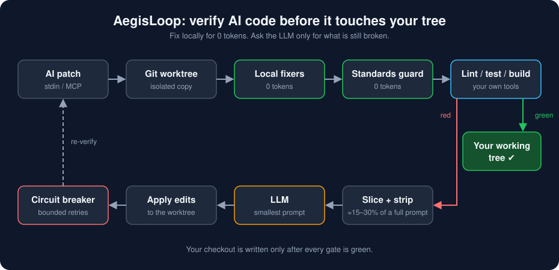

# AegisLoop

[](https://github.com/manishsongirkar/aegisloop/actions/workflows/ci.yml)
[](https://github.com/manishsongirkar/aegisloop/releases/latest)
[](LICENSE)
[](go.mod)

<p align="center"></p>

**An AI guardrail and local self-healing verification wrapper for AI-generated code.**

AegisLoop sits between your AI coding assistant and your working tree. It intercepts a patch, applies it in an
isolated git worktree, fixes everything it can **locally for zero tokens**, enforces your coding standards
(WordPress VIP, tabs, short arrays, secure escaping…), runs your lint / test / build / security gates, and — only for
what is still broken — asks an LLM for a fix using the **smallest possible prompt**. The loop is bounded by a
circuit breaker. Your checkout is written to **only after every gate is green**.

Works with **Claude Code, Cursor and VS Code Copilot** (through its built-in **MCP server**), or from the command line and CI.
Built for **WordPress / WordPress VIP (PHP)**, **JavaScript / TypeScript** and **Go** projects, and runs fully local with Ollama.
Keywords: AI code review, AI code verification, self-healing code, LLM token savings, prompt compression, phpcs, eslint,
Model Context Protocol.

```
  AI patch (stdin / MCP)
        │
        ▼
  git worktree (isolated)
        │
        ▼
  local fixers (0 tokens)
        │
        ▼
  standards guard (0 tokens)
        │
        ▼
  lint / test / build (your tools) ◀──────────────────────┐
        │                                                 │
        ├── green ──▶ your working tree                   │
        │                                                 │
        └── red ───▶ slice + strip                        │
                     (≈15–30% of a naive prompt)          │
                          │                               │
                          ▼                               │
                         LLM ──▶ edits ──▶ circuit breaker┘
                                           (bounded loop)
```

- [1. Introduction & value proposition](#1-introduction--value-proposition)
- [2. Installation](#2-installation)
- [3. Quick start](#3-quick-start)
- [4. IDE & MCP integration](#4-ide--mcp-integration)
- [5. How it saves tokens](#5-how-it-saves-tokens-architecture)
- [6. Configuration reference](#6-configuration-reference-aegisyml)
- [7. Troubleshooting & FAQ](#7-troubleshooting--faq)
- [8. Contributing & license](#8-contributing--license)

---

## 1. Introduction & value proposition

AI assistants write plausible code that routinely violates house rules: spaces instead of tabs, `array()` instead of
`[]`, unescaped output, `$wpdb` queries without `prepare()` or caching, unsanitized `$_GET`. The usual remedy — paste the
linter output back into the chat — burns tokens on whole files and screens of stack-trace noise, and a retry loop
without a limit can burn them forever.

AegisLoop removes that waste:

| Problem | What AegisLoop does | Cost |
|---|---|---|
| Trivial style errors (indentation, array syntax, formatting) | Runs `phpcbf`, `eslint --fix`, `stylelint --fix`, `prettier`, `gofmt` and two built-in fixers **before** any model call | **0 tokens** |
| Whole files sent back to the model | Sends only the enclosing function/class/rule of each failing line, with signature and line numbers (Go uses the real AST; PHP/JS/TS/CSS use masked brace matching) | **~0.5–5 %** of the file |
| Stack-trace noise | Strips `vendor/`, `node_modules/`, runtime frames, progress dots, banners; keeps assertion text and your own frames | **70–95 % smaller** output |
| Runaway loops | Circuit breaker: `max_retries`, no-progress, thrashing, regression and unusable-reply detection | bounded |
| Half-broken code in your tree | Everything happens in a worktree; promotion is all-or-nothing | **0 risk** |
| Hard-coded secrets, `eval`, XSS sinks | Built-in standards guard, applied to *added/changed lines only* | **0 tokens** |

Measured by this repository's own test-suite (`go test -v ./...`):

| Scenario | Whole-file / naive loop | AegisLoop | Saving |
|---|---|---|---|
| Error inside one function of a 15 000-token PHP file (`TestPrunerTokenReductionOnBloatedFile`) | ≈15 199 tokens | ≈70 tokens | **99.5 %** |
| One heal attempt on a 400-function PHP file (`TestHealSucceedsWithMinimalPrompt`) | ≈4 354 tokens | ≈575 tokens (incl. system prompt) | **87 %** |
| WordPress VIP regression project, end to end (`TestRegressionWordPressVIP…`) | ≈4 340 tokens | ≈868 tokens | **80 %** |
| PHPUnit failure with 200 vendor frames (`TestStripNoiseKeepsSignalDropsVendor`) | raw output | stripped | **> 80 %** |

Token counts use a 4-bytes-per-token estimate (`internal/tokenizer.EstimateTokens`); they are for budgeting, not billing.
Savings on your project depend on file sizes and how noisy your tools are — small files save less because the fixed
system prompt dominates.

---

## 2. Installation

AegisLoop is a single static Go binary (Go ≥ 1.22 to build; on macOS use a current Go release, because Go 1.22 binaries do not start on recent macOS; **no third-party Go dependencies**) and needs `git` ≥ 2.20
at run time. Your own tools (`phpcs`, `eslint`, `phpunit`, `jest` …) are optional — a missing tool is skipped with a
note unless you mark it `required: true`.

### Prebuilt binary (macOS, Linux, Windows)

Download the archive for your system from the [latest release](https://github.com/manishsongirkar/aegisloop/releases/latest),
check it against `checksums.txt`, and put `aegis` on your `PATH`:

```bash
# example: macOS on Apple silicon
tar -xzf aegis_1.0.0_darwin_arm64.tar.gz
sudo mv aegis /usr/local/bin/
aegis version
```

### With Go (≥ 1.22)

```bash
go install github.com/manishsongirkar/aegisloop/cmd/aegis@latest
```

### From source

```bash
git clone https://github.com/manishsongirkar/aegisloop.git ~/Projects/aegisloop
cd ~/Projects/aegisloop
make install                      # builds and installs aegis and aegisloop to $(go env GOBIN, else GOPATH/bin)
# or simply:
go install ./cmd/aegis            # installs `aegis`
aegis version
```

`./scripts/install.sh` does the same without `make` and prints the `PATH` hint if needed.

> **`aegis: command not found`?** Add the install folder to your PATH, then open a new terminal:
> `echo 'export PATH="$(go env GOPATH)/bin:$PATH"' >> ~/.zshrc` (use `~/.bashrc` for bash).
> `make build` only builds `bin/aegis` and `bin/aegisloop` inside the checkout, without installing them.

### Package-manager one-liners (after you publish)

Only the npm shim ships in this repository (`packaging/npm`); there is no Homebrew formula yet. Neither channel works until *you* publish it:

```bash
brew install aegisloop            # needs a Homebrew tap/formula that builds ./cmd/aegis
npx aegisloop init                # packaging/npm is a ready-to-publish shim: it finds `aegis` on PATH,
                                  # otherwise builds it with `go build` from the package's bundled source
```

### Global setup

```bash
aegis init                        # per project: detect the stack and write .aegis.yml
export ANTHROPIC_API_KEY=…        # or OPENAI_API_KEY; Ollama and `command` providers need no key
```

Editor integration (Cursor, VS Code, Claude Code) is covered in [section 4](#4-ide--mcp-integration).

---

## 3. Quick start

```bash
cd your-project          # must be a git repository with at least one commit
aegis init               # detects composer.json / package.json / .phpcs.xml / go.mod → writes .aegis.yml
$EDITOR .aegis.yml       # set llm.provider (or keep "none" for editor/MCP mode), tweak steps
aegis verify             # verify (and heal) the uncommitted changes in your working tree
```

### The four ways to run it

```bash
# 1. Verify what is already in your working tree (typical after an assistant edited files)
aegis verify

# 2. Intercept a patch before it touches your tree
git diff > ai.patch && git checkout . && aegis run --patch ai.patch
curl … | aegis run --patch -               # or pipe it in

# 3. Let the configured LLM implement a change, then verify/heal it
aegis fix "Add a cached helper that returns the latest 5 posts for an author" inc/render.php

# 4. Run as an MCP server so the editor's agent calls it itself
aegis mcp
```

Useful flags (all of `run`, `verify`, `fix`): `--dry-run` (do everything, write nothing, print the proposed diff),
`--no-heal` (local gates only), `--max-retries N`, `--provider/--model`, `--keep` (keep the sandbox after success),
`--json`, `-q`.

### What a run looks like

```
$ aegis verify
sandbox .aegis-sandbox/2315eb44-… (branch aegis-fix-2315eb44)
verifying (zero-token fixers first)…
  fixer  tabs           fixed 1 file(s) locally
  fixer  short-arrays   fixed 1 file(s) locally
  check  standards      failed (5 finding(s))
  check  php-lint       passed
heal attempt 1/3: 5 failure(s), ~540 prompt tokens via anthropic:claude-sonnet-5-5
  applied 1 edit(s) to inc/render.php
  fixer  tabs           clean
  check  standards      passed
✔ PASSED — every gate is green
  zero-token local fixes: inc/render.php
  LLM heal attempts: 1
  tokens: ~868 sent, ~185 received; a naive loop would send ~4340 (80% saved)
  written to working tree: inc/render.php
```

### Exit codes

| Code | Meaning |
|---|---|
| `0` | All gates passed and the result was written to the working tree (unless `--dry-run`), or there was nothing to verify (clean tree, empty patch) |
| `1` | Verification failed or the circuit breaker tripped (diagnostics printed, working tree untouched) |
| `2` | No LLM configured/allowed: free local fixes were applied, a compact fix request was printed |
| `3` | Usage, configuration or infrastructure error (not a git repo, bad `.aegis.yml`, patch rejected…) |

### Other commands

| Command | Purpose |
|---|---|
| `aegis init [--force]` | Detect the stack and write `.aegis.yml` |
| `aegis prune file.php:42[,57]` | Print only the enclosing function around those lines, plus the token saving |
| `aegis rules` | List the built-in standards rules |
| `aegis clean [--list]` | Remove (or list) preserved sandboxes |
| `aegis mcp [--repo dir]` | MCP server on stdio |

---

## 4. IDE & MCP integration

`aegis mcp` speaks the Model Context Protocol over stdio (newline-delimited JSON-RPC 2.0) and exposes:

| Tool | What it does |
|---|---|
| `verify_and_heal_patch` | Verify (and heal) a patch or the working-tree changes. Args: `repo_path`, `patch`, `heal`, `dry_run`, `max_retries` |
| `run_spec_test_loop` | Alias of the above for assistants that think in "spec → test" loops |
| `prune_context` | Enclosing function/class around given lines of a file (token-minimal context) |
| `strip_trace` | Noise-strip raw lint/test output |

**Two modes.** With `llm.provider: none` (the default) the *editor's own model* is the healer: the tool runs the free
local fixers (and writes their result into your tree), then returns a compact fix request — the failing function
slices plus stripped output — which the agent applies with its normal edit tools and re-calls the tool. With a
provider configured, AegisLoop heals by itself inside its circuit breaker and the agent only sees the verdict.
Pass `heal: false` to force the first mode.

### Cursor

`~/.cursor/mcp.json` (global) or `.cursor/mcp.json` (project):

```json
{
  "mcpServers": {
    "aegisloop": {
      "command": "aegis",
      "args": ["mcp"]
    }
  }
}
```

Then add a rule (Settings → Rules, or `.cursor/rules/aegisloop.mdc`):
*"After you create or edit code, call `verify_and_heal_patch` and fix whatever it reports before finishing."*

### VS Code (GitHub Copilot agent mode)

`.vscode/mcp.json`:

```json
{
  "servers": {
    "aegisloop": {
      "type": "stdio",
      "command": "aegis",
      "args": ["mcp"]
    }
  }
}
```

Open Copilot Chat in *Agent* mode, enable the `aegisloop` tools in the tool picker, and add the same instruction to
`.github/copilot-instructions.md`.

### Claude Code

```bash
claude mcp add aegisloop -- aegis mcp          # add --scope project to share it via .mcp.json
```

or commit `.mcp.json`:

```json
{
  "mcpServers": {
    "aegisloop": {
      "command": "aegis",
      "args": ["mcp"]
    }
  }
}
```

and put in `CLAUDE.md`: *"Before finishing any task that changes code, run the `verify_and_heal_patch` tool."*
(Hook users can also run `aegis verify -q --no-heal` from a `PostToolUse` hook.)

If the editor starts the server outside your project, pass `--repo /abs/path` in `args`, or let the agent supply
`repo_path`. Logs go to stderr; stdout carries only protocol messages.

> **Visual checks.** AegisLoop does not process images. If you want visual-regression previews, call the editor's own
> registered image tool (for example `image_agent:fetch_images`) from the agent; to gate on screenshots, add a
> Playwright step to `checks:` and AegisLoop will run it like any other test command.

---

## 5. How it saves tokens (architecture)

```
cmd/aegis            CLI: init · run · verify · fix · prune · rules · clean · mcp
internal/config      .aegis.yml loader (dependency-free YAML subset), validation, stack auto-detection
internal/sandbox     git worktree isolation, baseline snapshot, diff/promote/prune
internal/runner      fixers → checks orchestration, built-in fixers, standards guard
internal/tokenizer   comment/string masker, AST slicer, failure parser, trace stripper, prompt builder
internal/healer      bounded loop, circuit breaker, edit parser/applier, LLM providers, pipeline
internal/mcp         MCP stdio server
```

### 5.1 Sandbox: nothing touches your tree until it is green

`git worktree add .aegis-sandbox/<uuid> -b aegis-fix-<id>` creates a zero-copy checkout. Your uncommitted changes
(modified, deleted, untracked, but not ignored) are snapshotted into it as a baseline commit, so later diffs contain
exactly what AegisLoop changed. `vendor/` and `node_modules/` are symlinked in so tools work. Every fixer, test run and
LLM edit happens there. On success the diff is applied with `git apply` — **all or nothing**: if you edited the same
lines meanwhile, nothing is written and the verified patch is saved for you. `.aegis-sandbox/` is added to
`.git/info/exclude` automatically.

### 5.2 Zero-token pre-fixes (the formatting gate)

Before *every* verification — including after each LLM edit — the `fixers:` run: `phpcbf`, `eslint --fix`,
`stylelint --fix`, `prettier --write`, `gofmt -w`, plus two in-process fixers that need no tools at all:

- `builtin:tabs` converts leading spaces to tabs (4 columns per tab, remainder kept for alignment), skipping heredocs
  and multi-line strings whose whitespace is data.
- `builtin:short-arrays` rewrites `array( … )` to `[ … ]` using a comment/string-aware scanner (it will not touch
  `is_array(`, `(array)` casts, `$x->array()`, strings, comments or inline HTML), without ever changing line counts.

Both only touch lines you added or changed. In practice this resolves the large majority of mechanical violations
before a model is involved.

### 5.3 AST-aware surgical slicing

For each located failure the slicer returns the *innermost enclosing function* (with its docblock and a one-line
signature), numbered with real file line numbers:

- **Go** — real `go/parser` AST (functions and declarations).
- **PHP / JS / TS / CSS** — braces are matched on a *masked* copy of the source (strings, comments, heredocs, template
  literals and inline HTML blanked, same length) so a `}` in a string cannot confuse it; control blocks (`if`, `foreach`)
  are skipped in favour of the function around them.
- A failing line in a class body (not a method) gets a ±`context_lines` window; a function longer than
  `max_slice_lines` is reduced to *signature + window around the error + omission markers*. Overlapping slices merge.

**Code under test.** A failing test is reported at its assertion, not at the bug. For `test` and `build` checks, AegisLoop
also takes the names called by the failing slice and adds the matching functions from the files the patch changed
(marked *called by the failing code*, at most 6 per prompt). They are editable, so the model can fix the real cause
instead of the test. Only files in the verification scope are searched; a bug in a file you did not touch is not shown.

The model may only edit line ranges it was shown (`aegis-replace path start-end` blocks; SEARCH/REPLACE blocks and
unified diffs are accepted too), so a confused model cannot vandalise the rest of the file.

### 5.4 Noise-stripped failure ingestion

`internal/tokenizer` parses tool output into located failures (phpcs emacs, eslint unix & stylish, `go vet`/`go test`,
`tsc`, PHP parse/fatal errors, PHPUnit and Jest traces) and strips boilerplate: `vendor/` and `node_modules/` frames,
runtime/internal frames, PHPUnit banners and progress dots, npm/composer chatter, ANSI codes, duplicate lines
(collapsed to `(×N)`), and absolute paths. Dropped frames become one `… N framework/vendor frame(s) omitted` marker.
Lint findings are sent as one line each; raw output is only added for test/build failures and unlocated errors.

### 5.5 Bounded self-healing loop & circuit breaker

```
verify ─ pass ─▶ promote
   │ fail
   ├─ breaker.Observe(fingerprint)   ──▶ halt: no_progress · thrashing_detected · regressing
   ├─ breaker.Allow()                ──▶ halt: max_retries_exhausted
   ├─ prompt = failures + slices + stripped output
   ├─ reply → edits (range-checked)  ──▶ two unusable replies in a row: halt unusable_llm_reply
   └─ apply in sandbox → verify again
```

| Halt reason | Trigger |
|---|---|
| `max_retries_exhausted` | `max_retries` LLM calls were made and gates are still red (never one more) |
| `no_progress` | The same failures (fingerprint ignores line numbers and digits) remain after an attempt |
| `thrashing_detected` | An earlier failure state returned (A → B → A) |
| `regressing` | The number of failures grew on two consecutive attempts |
| `unusable_llm_reply` | The reply contained no applicable edit twice in a row (the 2nd prompt lists what was wrong) |
| `llm_error: …` / `interrupted` | Provider failure / Ctrl-C |

On any halt the sandbox is kept (or pruned, per `sandbox.on_failure`) and a diagnostic is printed.

### 5.6 Built-in standards guard

`builtin:standards` runs on added/changed lines only and understands PHP strings/comments/heredocs. Disable any rule
with `guard.disable` or an inline `// aegis:ignore` / `// phpcs:ignore` on the same or previous line.

| Rule | Catches |
|---|---|
| `tabs` | space indentation (`strict_tabs`) |
| `short-arrays` | `array()` (`strict_short_arrays`) |
| `escape-output` | `echo`/`print`/`<?=` operands that are not `esc_*`, `wp_kses*`, `absint`, casts, literals… (splits `.` and `,` operands) |
| `db-unprepared` | `$wpdb->query/get_*` with variables and no `prepare()` |
| `db-uncached` | direct `$wpdb->get_*` with no `wp_cache_*`/transient **in the same function** |
| `unsanitized-input` | `$_GET/$_POST/$_REQUEST/$_COOKIE/$_SERVER/$_FILES` without sanitising/validation |
| `forbidden-function` | `eval`, `create_function`, `extract`, `unserialize`, `shell_exec`, `exec`, `system`, `passthru`, `popen`, `proc_open`, `query_posts`, `assert` |
| `debug-leftover` | `var_dump`, `print_r`, `error_log`, `console.log`, `debugger`… |
| `no-eval`, `xss-innerhtml` | JS `eval`/`new Function`; `innerHTML`, `insertAdjacentHTML`, `document.write`, `dangerouslySetInnerHTML` |
| `hardcoded-secret` | AWS keys, private keys, `password = '…'`, Stripe/GitHub tokens |

The guard is a fast, deterministic *heuristic* layer. It complements — it does not replace — `phpcs` with
WordPress-VIP-Go, which stays in your `checks:`.

---

## 6. Configuration reference (`.aegis.yml`)

`aegis init` writes this file; every key is optional. Unknown keys are errors, so typos do not pass silently.
The YAML reader supports block maps/lists, inline lists, quoted scalars and comments (not anchors or multi-line scalars).

### Top level

| Key | Default | Meaning |
|---|---|---|
| `version` | `1` | Schema version |
| `language` | auto-detected | `php`, `js`, `go` or `auto` (informational) |
| `max_retries` | `3` | **Circuit breaker**: max LLM heal attempts per run (0–10) |
| `token_budget_alert` | `20000` | Warn when the estimated prompt tokens sent in one run exceed this |
| `context_lines` | `10` | Window radius when no enclosing block exists |
| `max_slice_lines` | `120` | Longer blocks are elided to signature + window |
| `timeout_seconds` | `300` | Per-step timeout (whole process group is killed) |
| `strict_tabs` | `true` for PHP/WordPress, else `false` | Enforce tab indentation |
| `strict_short_arrays` | `true` for PHP | Enforce `[]` |

### `sandbox`

| Key | Default | Meaning |
|---|---|---|
| `dir` | `.aegis-sandbox` | Parent of the worktrees (relative, inside the repo) |
| `on_failure` | `preserve` | `preserve` keeps the worktree + saves `<id>.patch` for inspection; `prune` deletes it instantly. Your tree is untouched either way |
| `link` | `[vendor]` / `[node_modules]` | Paths symlinked from your checkout so tools find dependencies |

### `guard`

`enabled: true`, `disable: [rule-id, …]` (see the rules table; `aegis rules` lists them).

### `llm`

| Key | Meaning |
|---|---|
| `provider` | `anthropic`, `openai` (any OpenAI-compatible endpoint), `ollama`, `command`, or `none` |
| `model` | Defaults: `claude-sonnet-5-5`, `gpt-4o-mini`, `qwen2.5-coder:7b` — set what you actually use |
| `endpoint` | Override base URL (OpenRouter, Azure-compatible proxies, remote Ollama…) |
| `api_key_env` | Env var holding the key (defaults `ANTHROPIC_API_KEY`, `OPENAI_API_KEY`). Keys are never written to config or logs |
| `command` | For `provider: command`: a shell command that reads the prompt on stdin and prints the reply, e.g. `claude -p`, `ollama run qwen2.5-coder`, `llm -m gpt-4o` |
| `max_tokens`, `timeout_seconds` | Per-call limits (429/5xx are retried twice) |

### `fixers` / `checks`

Each entry:

| Key | Meaning |
|---|---|
| `name` | Unique within its list |
| `run` | Command template, split shell-style and executed **directly** (no shell). `{files}` expands to all matching changed files as separate arguments; `{file}` runs the command once per file. `builtin:tabs`, `builtin:short-arrays` (fixers) and `builtin:standards` (check) are in-process |
| `extensions` | Only run (and only pass files) with these extensions; skipped with a note when none changed. Omit to always run |
| `kind` | `lint`, `test`, `build`, `security` — tests and builds also send stripped raw output to the model |
| `ok_exit_codes` | Exit codes that count as success (fixers: `phpcbf` exits 1 when it fixed something) |
| `required` | A missing tool fails the step instead of skipping it |
| `shell` | Run through `sh -c` (pipes, `&&`); file arguments are quoted for you |

Tools are looked up in `vendor/bin`, `node_modules/.bin`, then `PATH`; relative paths (`./bin/lint`) resolve inside the sandbox.

### Example: WordPress VIP

```yaml
version: 1
language: php
max_retries: 3
strict_tabs: true
strict_short_arrays: true
sandbox:
  on_failure: preserve
  link: [vendor]
llm:
  provider: anthropic
  model: claude-sonnet-5-5
fixers:
  - name: tabs
    run: "builtin:tabs"
    extensions: [php, js, css]
  - name: short-arrays
    run: "builtin:short-arrays"
    extensions: [php]
  - name: phpcbf
    run: "phpcbf --standard=WordPress-VIP-Go {files}"
    extensions: [php]
    ok_exit_codes: [0, 1]
checks:
  - name: standards
    run: "builtin:standards"
    kind: security
    extensions: [php, js]
  - name: php-lint
    run: "php -l {file}"
    kind: lint
    extensions: [php]
  - name: phpcs
    run: "phpcs --standard=WordPress-VIP-Go --report=emacs -q {files}"
    kind: lint
    extensions: [php]
  - name: phpunit
    run: "phpunit --colors=never"
    kind: test
    extensions: [php]
```

### Example: React / Next.js (TypeScript)

```yaml
version: 1
language: js
strict_tabs: false
sandbox:
  link: [node_modules]
llm:
  provider: openai
  model: gpt-4o-mini
fixers:
  - name: eslint-fix
    run: "eslint --fix --no-warn-ignored {files}"
    extensions: [js, jsx, ts, tsx]
    ok_exit_codes: [0, 1]
  - name: prettier
    run: "prettier --write {files}"
    extensions: [js, jsx, ts, tsx, css, json]
checks:
  - name: standards
    run: "builtin:standards"
    kind: security
    extensions: [js, jsx, ts, tsx]
  - name: eslint
    run: "eslint -f unix --no-warn-ignored {files}"
    kind: lint
    extensions: [js, jsx, ts, tsx]
  - name: tsc
    run: "tsc --noEmit --pretty false"
    kind: build
    extensions: [ts, tsx]
  - name: jest
    run: "jest --findRelatedTests {files} --passWithNoTests --colors=false"
    kind: test
    extensions: [js, jsx, ts, tsx]
  - name: build
    run: "npm run build --silent"
    kind: build
    extensions: [js, jsx, ts, tsx]
```

### Example: general Node + PHP monorepo with a local model

```yaml
version: 1
max_retries: 2
timeout_seconds: 600
sandbox:
  link: [vendor, node_modules]
llm:
  provider: ollama
  model: qwen2.5-coder:14b
fixers:
  - name: phpcbf
    run: "phpcbf --standard=PSR12 {files}"
    extensions: [php]
    ok_exit_codes: [0, 1]
  - name: prettier
    run: "prettier --write {files}"
    extensions: [js, ts, json]
checks:
  - name: phpstan
    run: "phpstan analyse --error-format=raw --no-progress {files}"
    kind: lint
    extensions: [php]
  - name: phpunit
    run: "phpunit --colors=never"
    kind: test
    extensions: [php]
  - name: npm-test
    run: "npm test --silent"
    kind: test
    extensions: [js, ts]
  - name: e2e
    run: "npx playwright test --reporter=line"
    kind: test
    extensions: [js, ts]
```

---

## 7. Troubleshooting & FAQ

**`AegisLoop needs a git repository` / `no commits yet`** — run `git init && git add -A && git commit -m init`.
Worktrees need a commit to branch from.

**The tool says `skipped — tool not found: phpcs`.** Missing tools are skipped by design so a half-configured machine
still gets the free gates. Install the tool (Composer: `composer require --dev …`), or set `required: true` to make it a failure.

**`check standards failed` but my line is fine.** The guard is heuristic. Add `// aegis:ignore` (or `// phpcs:ignore`) on that
line or the one above, or switch the rule off in `guard.disable`.

**`the working tree changed while AegisLoop was running`.** A file in your checkout (any file, not only the ones being
written) or `HEAD` changed after the run started, so the verdict no longer describes your tree. Nothing was written; the
error names the files. Re-run `aegis verify`, or `git apply .aegis-sandbox/<id>.patch` after resolving, then `aegis clean`.

**`NOTHING TO VERIFY`.** There are no uncommitted changes (or the patch changed nothing). This is not a failure (exit `0`).
If a run says `PASSED` with a note that *no fixer or check applied*, the changed files matched no step's `extensions`.

**What does each circuit-breaker halt mean?** See the table in [5.5](#55-bounded-self-healing-loop--circuit-breaker).
`no_progress` and `thrashing_detected` mean the model is not converging — fix the remaining items by hand (they are
printed), or raise the model tier; raising `max_retries` will not help.

**Can it loop forever or run up a bill?** No: at most `max_retries` model calls per run, plus one optional
generation call for `aegis fix`; `token_budget_alert` warns on large runs; every step has a timeout.

**Is my working tree ever modified by a failed run?** No. The only writer is *Promote*, and it runs only after all
gates pass (or, in no-LLM mode, to apply the deterministic local fixes).

**Where does my code go?** Only to the provider you configure, and only the failing slices plus stripped output.
Use `ollama` or a `command` provider for fully local operation.

**Manual worktree recovery**

```bash
aegis clean --list                 # list preserved sandboxes
aegis clean                        # remove them all (worktree + branch + patch)

# by hand, if needed:
git worktree list
git worktree remove --force .aegis-sandbox/<uuid>
git branch -D aegis-fix-<first-8-chars-of-uuid>
git worktree prune
```

After a crash or `kill -9` the sandbox simply stays behind; `aegis clean` handles it.

**Windows.** The binary builds and the fixers/guard/MCP server are portable; `command` providers and `shell: true`
steps need `sh` (Git Bash/WSL).

**Does it do visual regression?** No — see the note in [section 4](#4-ide--mcp-integration).

**Limits worth knowing.** Slicing for PHP/JS/CSS is heuristic brace matching, not a full parser (Go is real AST); code
inside heredocs/template literals is masked, not analysed; `escape-output` examines single statements; the token
counts are estimates. When a slice is not enough context the model can only edit what it was shown — failures then
surface as `no_progress`, which is the safe outcome.

---

## 8. Contributing & license

See [CONTRIBUTING.md](CONTRIBUTING.md). Short version: `make test` (race detector on), `make vet`, keep `gofmt` clean, add a
regression test next to any bug fix, and keep the binary dependency-free (standard library only).

Licensed under the **MIT License** — see [LICENSE](LICENSE).
